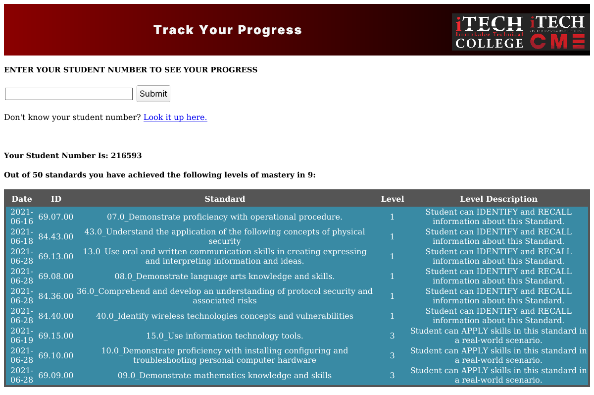
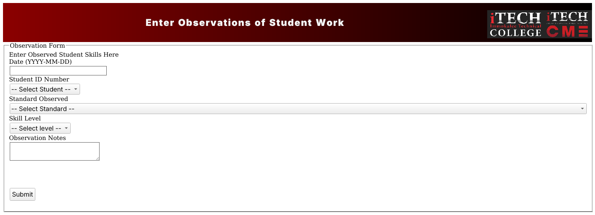
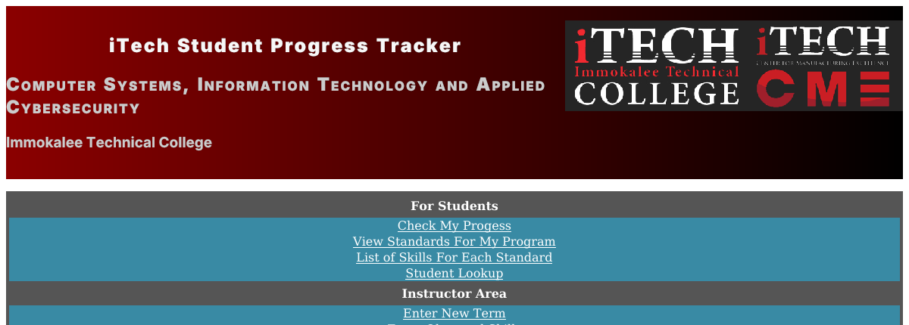

# iTech Differentiated OCP Tracker

A PHP/MySQL web application that maps student skill mastery against Florida Department of Education curriculum frameworks — and a security review of my own code, five years later.

**Amy McMullin** · LIS 5367, M.S. Information Technology, Florida State University · Summer 2021

| | |
|---|---|
| **Stack** | PHP, MySQL, HTML, CSS |
| **Hosting (2021)** | AWS EC2 (Amazon Linux) + Amazon RDS for MySQL |
| **Schema** | 11 tables, 3rd normal form |
| **Reference data** | 50 standards · 245 skills · 51 assignments · 4 OCPs |
| **Status** | Original AWS account and GitHub repo no longer accessible; restored here from a local backup |

---

## The problem

Florida's career certificate programs are built around **Occupational Completion Points** — a student earns an industry-recognized credential by demonstrating mastery of a defined list of standards and skills, not by accumulating seat time. Program Y100200 (Computer Systems & Information Technology), which I teach, has four OCPs, 50 standards and 245 individual skills beneath them.

Tracking that on paper is miserable. A student halfway through has demonstrated some standards through coursework, others by doing live work around the building, and has no clear view of what's left. The instructor has the same problem in reverse.

The application does three things:

1. **Shows a student their own progress** — which standards they've mastered, at what level, and what remains.
2. **Lets an instructor record skills observed during work-based activities**, not just graded assignments. This is the differentiation piece: a student who struggles with a written test can demonstrate the same standard by installing a workstation, and it counts.
3. **Maps assignments to framework standards**, so coursework and credential requirements stay connected.



Mastery is recorded at four levels, from *can identify and recall* through *can apply in a real-world scenario* — so progress is a gradient rather than a pass/fail.

## Architecture

The project began on a local Ubuntu VM running a LAMP stack. To improve availability I migrated it to AWS: the web server and PHP onto an EC2 instance running Amazon Linux, and the MySQL database onto Amazon RDS. The goal was to decouple the application from its data, so either could be scaled, restored or replaced without the other.

Everything here was new to me at the time — I came from the infrastructure side, not development. The HTML, PHP, SQL, Git workflow and the third-party API call on the home page were all first attempts.

## Data model

Eleven tables in third normal form, mirroring how the DOE framework is actually structured:

```
programs ──< OCPs ──< Standards ──< skills
                           │
                           └──< assignments >── levels
students ──< enrollment >── programs
students ──< earnedOCP >── assignments
students ──< Observations >── Standards
```

The separation that does the real work is `assignments` versus `Observations`. An assignment is a graded artifact tied to a standard; an observation is an instructor watching a student do the thing. Both resolve to the same standard, which is what makes alternate demonstration of mastery possible instead of bolted-on.



---

## Security review, 2021 → 2026

I now teach applied cybersecurity. Reading my own code back is a useful exercise, so here is an honest audit rather than a polish.

**What I already knew was wrong.** My original write-up listed hardening as future work: input validation, SQL sanitization, restricting access by user, and OAuth2 pass-through from Canvas. I also noted in the demo instructions that "a real-world implementation would not allow unauthorized users to lookup student information." So the gaps were visible to me at the time — I just didn't have the skills to close them yet.

**What I'd flag now, specifically:**

- **SQL injection, everywhere.** User input is interpolated straight into query strings:
  ```php
  $sql = "SELECT ... WHERE stuID='$selected'";
  ```
  Every query in `fullprogresscheckgood.php`, `lookupstudent.php` and `observe.php` has this shape. The fix is prepared statements with bound parameters — `mysqli_prepare` / `bind_param` — not escaping.
- **Credentials committed to the repository.** `conn.php` carried a live RDS hostname, username and password in plaintext, and a second set sat in a commented-out block in `fullprogresscheck.php`. They are redacted in this restoration. Rotating a leaked credential is easy; noticing it leaked is the hard part, which is why they belong in environment variables from day one.
- **No authentication or authorization at all.** Any visitor can retrieve any student's record by ID, or list every student in the program. For a system holding education records this is the most serious issue on the list — it's a FERPA problem before it's a security problem.
- **Stored XSS.** Observation notes are free text entered by an instructor and echoed back unescaped (`echo $row['standardDesc']`). Output needs `htmlspecialchars` regardless of how much you trust the input.
- **Client-trusted identifiers.** `observe.php` takes `stuID` from a POST field and writes it directly. Nothing verifies the submitter is allowed to write to that student.
- **Random integers as primary keys.** `$earnID = rand(1, 999999999)` with no uniqueness check — a collision silently fails the insert. The column should be `AUTO_INCREMENT`.
- **Code that doesn't run.** `$mysqli->close()` appears at the end of several pages but `$mysqli` is never defined — on PHP 8 this is a fatal error after the page body has already rendered. `$GET['$selected']` on line 23 of `fullprogresscheckgood.php` is dead: the superglobal is `$_GET`, and the key is quoted wrong. Several form fields are literally named `$stuID`, dollar sign included.

Nothing in that list is unusual for a first web application. Publishing it unedited is the point — the gap between "it works" and "it's safe to put in front of real students" is exactly what I spend my time teaching now.

## About the data in this repository

**The original database contained real student records** — 19 names from an actual cohort, paired with skill-mastery data and free-text observations naming students and staff. That dump is not published here.

`database/seed-demo.sql` is a de-identified replacement: invented names, regenerated student IDs, rewritten observation notes, with foreign keys remapped so the data stays internally consistent. Row counts and relationships match the original, so the application behaves identically. The curriculum data — standards, skills, assignments, OCPs — comes from the published Florida DOE framework and is unchanged.

The screenshots in this repository were taken from a local restoration running against that demo data.

## Running it locally

```bash
mysql -u root -e "CREATE DATABASE ocp_tracker"
mysql -u root ocp_tracker < database/schema.sql
mysql -u root ocp_tracker < database/seed-demo.sql

cp conn.example.php conn.php     # then set your credentials
php -S 127.0.0.1:8080
```

Then open `http://127.0.0.1:8080/index.php`. Student `216593` has mastery records to display. Note that the `$mysqli->close()` fatal described above will still bite on PHP 8 — it is left in place deliberately, since fixing it would misrepresent the original code.

The home page calls a third-party joke API, which was the one piece of pure fun in the project. If you're offline, that block simply renders empty.



## Repository contents

```
*.php, *.html, styles.css   The application, as submitted in 2021 (credentials redacted)
conn.example.php            Connection template — the original hard-coded live credentials
database/schema.sql         DDL for all 11 tables
database/seed-demo.sql      De-identified demo data
screenshots/                Captured from a local restoration
docs/original-write-up.pdf  The project write-up as submitted
```

## Provenance

Originally at `github.com/AJMFSU/LIS5367` and deployed at `apps.themcmullin7.com`. Both the GitHub account and the AWS account are no longer accessible to me; this repository is restored from a local archive of the working tree as it stood in July 2021.

Curriculum standards and skills are from the Florida Department of Education framework for program Y100200. The random-joke endpoint is David Katz's [Official Joke API](https://github.com/15Dkatz/official_joke_api).
